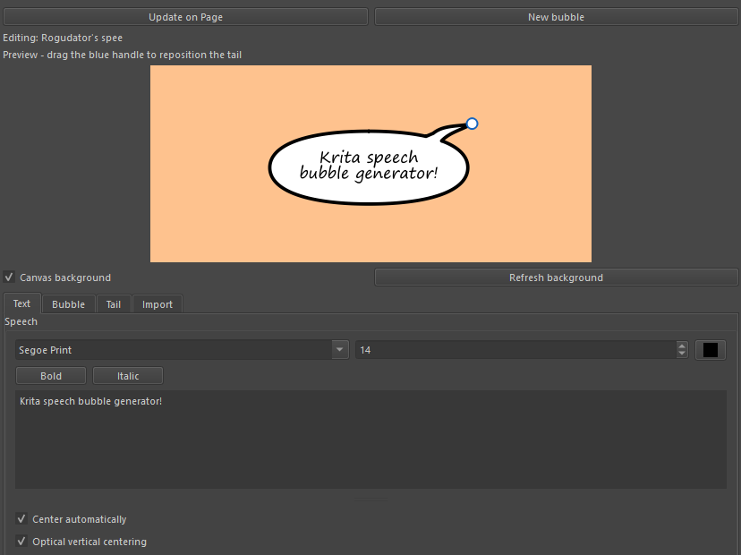

# Krita Speech Bubble Generator

Create and edit speech, thought and shouting bubbles without leaving Krita.
Enter your dialogue, choose a style and position the tail in the preview.

## Install

1. Download the plugin ZIP from the repository's [Releases page](../../releases).
   Use the plugin ZIP, not GitHub's **Source code** archive.
2. In Krita, choose **Tools > Scripts > Import Python Plugin...** and select
   the ZIP.
3. Restart Krita. If needed, enable **Krita Speech Bubble Generator** under
   **Settings > Configure Krita > Python Plugin Manager**, then restart again.
4. Open **Settings > Dockers > Krita Speech Bubble Generator**.

For manual installation, open **Settings > Manage Resources > Open Resource
Folder**. Copy `krita_speech_bubble_generator.desktop` and the
`krita_speech_bubble_generator/` folder from the ZIP into its `pykrita`
directory. Enable the plugin and restart Krita.

### Upgrading from the Rogudator-named version

Disable the old plugin first. To avoid duplicate dockers, remove its
`rogudators_speech_bubble_generator.desktop` file and
`rogudators_speech_bubble_generator/` folder from `pykrita`. Bubbles saved by
earlier versions of this fork remain editable without conversion.

## Create a bubble

1. Open a document and the plugin docker.
2. Enter dialogue in **Text**. Choose a style and appearance in **Bubble**.
3. In **Tail**, set a length and choose a direction, or drag the blue handle
   in the preview to aim the tail.
4. Choose **New vector layer** or **Selected vector layer**, then click
   **Add on Page**.
5. Move the bubble on the canvas with Krita's shape-selection tool. Click
   **New bubble** to start another.

The blue handle is an editing aid; it will not appear in your artwork. The
docker remembers your dialogue and options between sessions. It starts with an
Oval selected; new bubbles keep the current style, while selecting a saved
bubble loads its own settings.

## Customize

- **Text:** Choose a font, size and colour. Select words to make them bold or
  italic, or use **Ctrl+B** and **Ctrl+I**. Automatic wrapping is on by default;
  use line breaks or **Characters per line** to control it yourself.
- **Bubble:** Choose Oval, Rounded, Square, Thought or Shouting. Adjust padding,
  outline and fill. Ovals can use independent horizontal and vertical padding;
  shouting bubbles offer several spike shapes and adjustable nodes.
- **Tail:** Use the compass for set directions or drag for any angle. **Lock
  tail length** keeps the length fixed while aiming; turn it off to change both
  direction and length. **Curve** bends the tail. Thought trails follow the
  curve too.
- **Copy Style:** Copy the appearance settings from one bubble and paste them
  onto another without replacing its dialogue.

The **Text**, **Bubble** and **Tail** tabs group related controls. The preview
can show nearby canvas artwork while you edit; use **Refresh background** after
changing other artwork.

## Edit bubbles

Select a generated bubble on the canvas with Krita's shape-selection tool.
Changes in the docker update it automatically after a short pause. Use
**Update on Page** to apply the current settings immediately.

Save your document as `.kra` to keep bubbles editable. Keep each generated
bubble group intact; manually edited shapes inside it are rebuilt when the
bubble is updated. Bubbles can be moved between vector layers or included in a
native vector-layer merge within the same document.

## Import an original Rogudator bubble

Select the old bubble's vector layer, open **Import**, then click
**Import old bubble**. The layer must contain one ungrouped bubble and its text;
layers with other artwork or multiple bubbles are not imported. If another
bubble is selected, click **New bubble** first.

Import keeps the original artwork's appearance until you edit it. **The first
edit redraws it with the current generator**, so its outline, text layout and
tail may change; per-word formatting such as bold is not preserved. Save a copy
first if you need to keep the original appearance. After importing, save as
`.kra` to edit the bubble normally in the future.

## Contributing

Bug reports, ideas and contributions are welcome. See
[CONTRIBUTING.md](CONTRIBUTING.md).

## Credits and license

Based on [Rogudator's Speech Bubble Generator](https://github.com/rogudator/rogudators_speech_bubble_generator)
by **Danil Zotin (rogudator)**, with additional styles, interactive previews
and saved-bubble editing developed in this fork. This is an independent
project, not an official Krita plugin.

Licensed under the [GNU General Public License v3](LICENSE).
