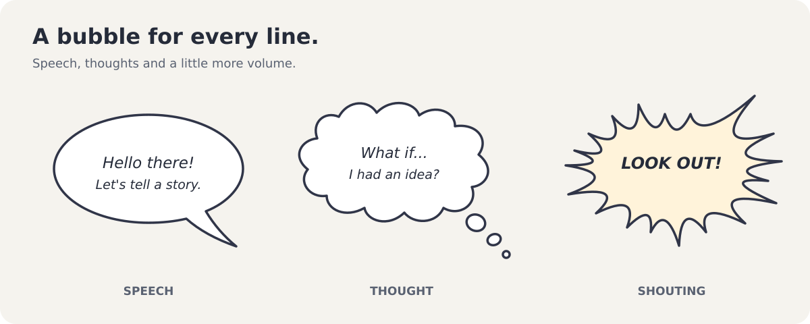

# Krita Speech Bubble Generator

Create speech, thought and shouting bubbles without leaving Krita. Type your
dialogue, choose a style, and drag the tail into place.

## Features

| Feature | What you can do |
| --- | --- |
| Five bubble styles | Choose Oval, Rounded, Square, Thought or Shouting. New and imported bubbles default to Oval. |
| Shouting shapes | Choose Balanced curves, Angular straight-sided spikes, Punchy's shorter, broader spikes, or Expressive curves with varied spacing and gentle lean. |
| Adjustable nodes | Set 8-64 nodes for more or fewer shouting spikes or thought-cloud lobes. Each bubble keeps its node counts. |
| Tail positioning and curves | Choose one of eight compass directions or drag freely in the preview, without snapping to corners or spikes. Keep a straight tail or adjust its curve amount and Up/Down direction, with an optional length lock. Thought trails can curve too. |
| Expressive shapes | Adjust thought-cloud irregularity, thought-trail blob size, and shouting-spike spacing with subtle height and valley-depth variation. Your pattern stays stable while you edit. |
| Text and appearance | Choose fonts, text size, fill and outline colours. Make selected words bold, italic, or both, with automatic wrapping and tight line spacing. Bubble sizing includes the formatted lettering, accents, descenders and overhanging letters. Control line breaks yourself when needed. Drag the grip below the text input to resize it. |
| Optical text centering | Optionally balance the visual weight of the lettering vertically, so blocks with longer upper lines do not look top-heavy. |
| Organised controls | Use the Text, Bubble and Tail tabs to find related options, or Import to recover moved bubbles or import old ones. The preview and page actions are shared across all tabs. |
| Bubble padding | Adjust the space around the text, with horizontal padding changing twice as strongly as vertical padding. At 0%, only the clearance needed for the outline and shape remains, without a built-in text-size margin. |
| Customisable ovals | Enable independent horizontal/vertical padding for flatter ovals around wide text, and adjust Squareness from an ellipse to a softly squared outline. Leave customisation off for the original fuller proportions. |
| Remembered options | Dialogue, font, colours, padding, layout, tail and style-specific options, canvas-background preference and layer destination are remembered between sessions. Each new bubble still defaults to Oval. |
| Live editing | Select a saved bubble to edit its text and appearance directly from the docker. Changes appear on the canvas after a short pause. |
| Canvas-aware preview | See the surrounding artwork while editing, so you can point the tail at the right character. |
| Flexible layers | Create a new vector layer or keep several independently editable bubbles on one layer. Move bubbles or merge vector layers without losing their editing settings. |
| Editable later | Save as `.kra` and return to your bubbles later, keeping their canvas position, rotation and scale when updating. |
| Import old bubbles | Recover editable text and appearance from a single original Rogudator bubble on its own vector layer. |
| Automatic reconnection | Older merged bubbles reconnect to uniquely matching saved settings when selected. |

## Installation

1. Download the plugin ZIP attached to a release on this repository's
   [Releases page](../../releases). Use the plugin ZIP, not GitHub's **Source code**
   archives.
2. In Krita, choose **Tools > Scripts > Import Python Plugin...** and select the ZIP.
3. Restart Krita. If needed, enable **Krita Speech Bubble Generator** under
   **Settings > Configure Krita > Python Plugin Manager**, then restart again.
4. Open **Settings > Dockers > Krita Speech Bubble Generator**.

For manual installation, open **Settings > Manage Resources > Open Resource
Folder**. Copy `krita_speech_bubble_generator.desktop` and the
`krita_speech_bubble_generator/` folder from the ZIP into its `pykrita` directory,
then enable the plugin and restart Krita.

### Upgrading from the Rogudator-named version

Disable the old plugin before installing this one. To avoid duplicate dockers,
remove its `rogudators_speech_bubble_generator.desktop` file and
`rogudators_speech_bubble_generator/` folder from `pykrita`.

Bubbles saved by earlier versions of this fork remain editable; no document
conversion is needed. For bubbles made with the original upstream plugin, use
**Import old bubble** as described below.

## Make your first bubble

1. Open a document and the **Krita Speech Bubble Generator** docker.
2. In the **Text** tab below the preview, enter your dialogue and choose a font.
   Open **Bubble** to choose a style, colours, outline and **Padding**.
   Padding controls the space around the text: 100% adds one text-size
   unit above and below, and two on each side. Reducing it tightens the horizontal
   space more quickly. At 0%, no optional margin is added: the bubble keeps only
   the clearance needed to contain the text within its shape and outline.
   Curved outlines can still leave some space beside the text.
3. In the **Tail** tab, set a length above zero, then click a compass direction
   or drag the blue preview handle to aim it.
   Leave **Lock tail length** on to change direction only, or turn it off to
   adjust both direction and length by dragging. Use **Curve** for a bent tail,
   and choose **Up** or **Down** for its direction; 0% keeps it straight.
4. Choose **New vector layer** or **Selected vector layer**, then click
   **Add on Page**.
5. Move the bubble on the canvas with Krita's shape-selection tool. Click
   **New bubble** in the docker when you are ready to create another one.

The docker remembers your dialogue and options when you restart Krita, including
changes made before adding a bubble to the page. New bubbles always start as
**Oval**, including when you leave an existing bubble to create another.
Selecting an existing bubble still restores that bubble's own saved style and
settings.

To emphasise individual words, select them in the text input and click **Bold**
or **Italic**, or press **Ctrl+B** or **Ctrl+I** while the input has focus.
Click again to remove that formatting. With no text selected, the controls
toggle formatting for what you type next. You can combine bold and italic.
Formatting appears in the preview and on the page, and is saved with the bubble
and remembered dialogue. Pasted text uses the input's current formatting rather
than bringing in fonts, colours or other formatting from another application.

**Center automatically** uses the original plugin's word-length-based wrapping.
For example, `Rogudator's speech bubble generator!` wraps as `Rogudator's`,
`speech bubble`, then `generator!`, regardless of the font or text size.
Explicit line breaks and blank lines are retained. Turn automatic centering off
to use **Characters per line**, or set that to zero to keep only your own breaks.

Enable **Optical vertical centering** in the **Text** tab when a geometrically
centered block still looks too high or low. It balances the visible lettering:
longer or heavier upper lines move the block downward, and heavier lower lines
move it upward. The bubble can grow taller to keep all lettering safely inside.
Wrapping, baseline spacing and the tail-length lock stay unchanged. This option
is saved with each bubble and remembered between sessions; it is off by default.
Leave it off for geometric centering with equal top and bottom layout gaps.

For a tighter oval around short, wide dialogue, select **Oval** in the **Bubble**
tab and enable **Customise oval**. The **Padding** control becomes **Horizontal
padding**; use **Vertical padding** independently to reduce the empty space above
and below the text. 100% adds twice the text size on each horizontal side, or
once the text size above and below. Customised ovals can be more than twice as
wide as they are tall.

Use **Squareness** to make the corners fuller and fit the text more closely:
0% is a true ellipse, and 100% is a softly squared oval with smooth corners.
Text wrapping and the tail-length lock stay unchanged. These options are saved
with each bubble and remembered between sessions. Turn **Customise oval** off
to return to the original proportions and linked padding, without losing the
custom vertical-padding and squareness values. Oval customisation stays off for
existing bubbles until you enable it.

The blue handle is only an editing aid; it does not appear in your artwork.
The **Tail** controls have two columns: position on the left, and the length lock
and length controls on the right. The length slider and integer input beside it
are always visible. Enable **Lock tail length** to edit either control; when
unlocked, both are disabled but show the current length as you drag the tail.
For a bubble without a tail, enable **Lock tail length** and set the length to zero.
With **Lock tail length** off, the blue handle stays visible even at zero length.
Drag it outward to create a tail, or into the bubble to reduce the length to zero.
The compass changes direction only, whether the length lock is on or off.
Its diagonals select 45-degree directions from the center of the bubble's body.
Straight tails stay symmetric around the center-to-tip line; the tail itself is not
included when finding the center. At zero length the compass sets the direction
for when you next extend the tail. Dragging allows any angle without snapping
to compass directions, rectangular corners or shouting spikes.
Short speech tails keep a broad base rather than becoming narrow slivers at low
lengths, so values such as 3 remain useful for small tails. Speech tails taper
to a sharp point rather than bulging outward. Curved tails ease back into the
pointing direction near the tip, avoiding a hooked end.
Below the position and length controls, **Curve** sets the bend from 0% (straight)
to 100%. **Direction** chooses **Up** or **Down**, relative to a tail pointing
right; the bend rotates with the tail when you aim it elsewhere. Curving keeps
the same tip position and length setting, which measures the straight distance
from the body to the tip, not the distance along the curve. For Thought bubbles,
the trail blobs follow the curve without changing their seeded pattern.
Resizing the text input keeps the preview height and the controls above it
unchanged.

For **Shouting** bubbles, open **Bubble**, choose a **Shape** in the Shouting
controls, then adjust **Irregularity**. All four shapes keep spike heights and
valley depths restrained, even at high irregularity. The shape is saved with
each bubble; switching shapes does not reset its random seed.

Use **Nodes** in the **Bubble** tab's Shouting or Thought controls to change the
number of spikes or cloud lobes. Higher counts give a denser outline; lower
counts give fewer, broader features. Shouting and Thought keep separate counts,
and changing the count leaves text layout, padding and the locked tail length
unchanged.

## Edit an existing bubble

Select a generated bubble on the canvas using
Krita's shape-selection tool. Its text and settings load into the docker, and
your changes always update the bubble automatically after a short pause.
The main button becomes
**Update on Page**, so it updates the selected bubble rather than adding another.
There is no separate manual-editing mode or live-update switch.

Older bubbles may fit more tightly after an edit because sizing now measures
the rendered text size and no longer adds a built-in minimum margin. Font sizes
and automatic line wrapping are unchanged.

**Canvas background** shows the nearby artwork in the preview while editing.
It follows the bubble when you move, rotate or scale it on the canvas. Use
**Refresh background** after changing other artwork.

Save your document in **Krita's `.kra` format** to keep bubble editing settings.
Keep the generated bubble group intact: updating rebuilds its contents, so
manual edits to individual vector shapes inside the group are not retained.

### Move bubbles and merge vector layers

Bubbles remain editable when moved between vector layers or after a native
vector-layer merge within the same document. Select a bubble normally to keep
editing; there is no recovery step after each merge. This also works for bubbles
with identical lettering or no lettering. Save as `.kra` to keep the settings.

Existing bubbles are upgraded automatically when loaded into the docker.
For older documents whose layers were already merged, selecting a bubble
automatically reconnects uniquely matching settings from the removed layers.
Missing settings, ambiguous matches, empty older lettering and altered group
structures are refused rather than guessed. Copying artwork into another
document does not transfer its editing settings.

The **Import** tab also has **Recover selected bubble** for explicitly retrying
reconnection. Other bubbles and artwork on the layer are left alone.
Reconnection itself does not redraw or reposition artwork. Save a copy before
editing older merged bubbles: their first edit fits the regenerated outline to
the previous placement, but may change shape, text layout or tail appearance.

### Import a bubble from the original Rogudator plugin

Select the old bubble's vector layer, open the **Import** tab, then click
**Import old bubble**. The tab explains the import process and its limitations.
If you are editing another bubble, click **New bubble** first.
Each layer must contain just one ungrouped bubble outline and its text.
Layers with other artwork, multiple bubbles or grouped shapes are refused
rather than risking changes to neighbouring artwork.

Import recovers the text, font, colours, outline width and original tail tip.
It fits the new tail length from the old body's bounding box and the regenerated
outline, keeping the tip's position as closely as the length control allows.
It joins the old text lines, enables **Center automatically**, selects
**Oval**, and fits padding to the old body's dimensions rather than applying the
new-bubble padding default. You can adjust these settings after importing.
It groups the existing shapes and
saves editing settings, but leaves the artwork's appearance unchanged until you
edit it or click **Update on Page**.

**The first edit redraws the bubble using the current generator.** Its outline,
text layout and tail can differ from the original, and per-word formatting such
as bold is flattened. The redraw retains the old body's canvas placement,
rotation and scale. Save a copy of your document first if you want to retain the
original artwork. After import, save as `.kra` to reopen the bubble normally
without importing it again.

## Contributing

Bug reports, ideas and contributions are welcome. See
[CONTRIBUTING.md](CONTRIBUTING.md) for reporting issues and working on the plugin.

## Credits and license

Based on [Rogudator's Speech Bubble Generator](https://github.com/rogudator/rogudators_speech_bubble_generator)
by **Danil Zotin (rogudator)**, with additional styles, interactive previews and
saved-bubble editing developed in this fork. This is an independent project,
not an official Krita plugin.

Licensed under the [GNU General Public License v3](LICENSE).
